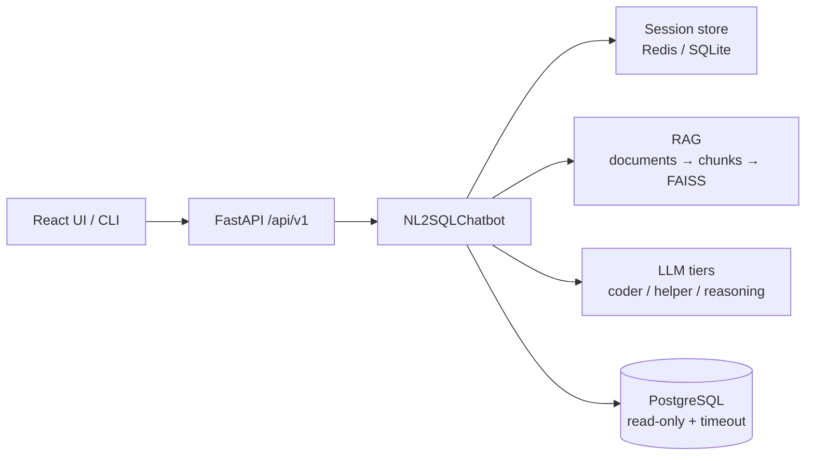

# NL2SQL Agent

[English](README_en.md) · [MIT License](LICENSE)

[](https://github.com/xifanz42/nl2sql_agent/actions/workflows/ci.yml)


面向 PostgreSQL 的自然语言查询 Agent：用中文或英文提问，系统检索领域文档、生成一条只读 SQL、执行并返回结果与分析。提供 FastAPI + React/TypeScript Web UI，以及命令行入口。

> **内部 / 自托管工具。** 当前没有登录、多租户或权限系统；部署时必须放在公司 SSO / 反向代理之后，不要直接暴露公网。

## 能力

| 能力 | 说明 |
|---|---|
| 自然语言查询 | 中文 / 英文问题 → RAG 检索 → SQL 生成 → 只读执行 → 结果分析 |
| Web UI | React + TypeScript；聊天记录、SQL、结果表、分析、中英切换、按需用量 |
| 命令行 | `python app/cli.py`，适合脚本或本地快速验证 |
| 会话 | Redis 优先，SQLite 自动 fallback；UUID 会话、TTL、短期压缩 |
| 文档上传 | 28 种扩展名（文本/代码、PDF、Office、EPUB）；默认 10 MB；uuid 文件名 |
| 查询安全 | 仅允许单条 `SELECT`；`sqlglot` 校验；只读事务 + 超时；结果行数上限 |
| 成本可观测 | 每请求 token 用量与预估人民币成本；结果过大时返回 `too_many_rows` |

## 快速开始

前置条件：

- Python 3.10+
- Node.js（建议 20+）
- 可访问的 PostgreSQL（自带数据库和 schema；项目不附带 demo 数据）
- SiliconFlow API Key（用于 SQL 生成、分析和轻量分类）

```bash
python -m venv .venv
source .venv/bin/activate
pip install -e ".[dev]"

cp .env.example .env
# 至少填写 SILICON_FLOW_API_KEY 和 DATABASE_*；Redis 可选
```

构建前端并启动：

```bash
cd web
npm install
npm run build
cd ..

uvicorn app.api.main:app --reload
# 打开 http://127.0.0.1:8000/
```

命令行方式：

```bash
python app/cli.py
```

运行测试与静态检查：

```bash
pytest
ruff check .
```

CI 在 Python 3.12 上运行同样的 `ruff` + `pytest`；前端构建目前由本地/发布流程执行。

## 架构



处理链路：问题 → 会话历史 → 探索/查询判断 → RAG 检索 → SQL 生成 → 共享 parser（SQL / 澄清 / 拒绝）→ `sqlglot` 校验 → 只读执行 → 结果分析。

## API

Base path：`/api/v1`。完整交互式契约可在运行后访问 `/docs`（Swagger）或 `/openapi.json`。

| Method | Path | 用途 |
|---|---|---|
| `GET` | `/health` | 存活检查 |
| `GET` | `/config` | 前端需要的公开上限（如消息长度） |
| `POST` | `/chat` | 自然语言提问 |
| `POST` | `/documents` | 上传 RAG 文档 |

提问：

```bash
curl -s http://127.0.0.1:8000/api/v1/chat \
  -H 'Content-Type: application/json' \
  -d '{"message":"查询 AT 车辆最近三天的平均导航速度"}'
```

响应包含 `session_id` 和 `result`；`result.kind` 可能是 `sql`、`clarification`、`refuse`、`exploration`、`execution_error`、`too_many_rows` 等。后续请求复用 `session_id` 即可延续会话。

上传文档：

```bash
curl -F "file=@notes.md" http://127.0.0.1:8000/api/v1/documents
```

上传默认上限 10 MB，支持文本/代码、PDF、DOCX、XLSX、PPTX、RTF、ODT、ODS、EPUB。非法文件名、扩展名或不支持的格式返回 400；超过大小返回 413。

## 安全与部署

- **没有 auth / 多租户。** 必须部署在 SSO 或反向代理之后，建议只 bind `127.0.0.1`。
- 反向代理负责限流、请求体大小（JSON 可设 1 MB，上传可设 12 MB）、读超时和 Host allowlist。
- SQL 层只接受单条只读查询；数据库连接设置 `READ ONLY` 和 `statement_timeout`。
- 生产环境应使用非 superuser 的只读数据库角色；最小权限角色和表 allowlist 仍在计划中。
- 会话 UUID 视为 bearer token，不要公开分享。
- 上传文档按不可信内容处理；解析失败会返回 4xx/5xx 并删除已写入的文件。
- 当前假设 **单 worker**：FAISS 索引和 KB 锁是进程内的，SQLite fallback 也不适合多进程。

## 配置

核心变量（完整列表见 [`.env.example`](.env.example)）：

| 变量 | 必需 | 说明 |
|---|---:|---|
| `SILICON_FLOW_API_KEY` | 是 | LLM API Key |
| `DATABASE_*` | 是 | PostgreSQL 连接参数（也支持 `DATABASE_URL`） |
| `REDIS_URL` | 否 | 会话存储；不可用时回退到 SQLite |
| `MAX_MESSAGE_CHARS` | 否 | 单条消息上限，默认 2000（可选 2000/4000/8000） |
| `MAX_UPLOAD_BYTES` | 否 | 文档上传上限，默认 10 MB |
| `EVAL_DATABASE_*` | 否 | 评测用只读角色；仅评测时需要 |

## 项目结构

```text
app/api       FastAPI 路由、请求/响应模型、上传处理
app/chatbot   对话编排、会话存储
app/core      数据库、LLM、RAG、解析、SQL 解析与校验
app/eval      评测 harness 与指标
app/models    Pydantic 模型
web           React + TypeScript 前端
tests         单元测试与 API 契约测试
eval_results  可公开的评测报告与历史
data          本地知识库文档目录（不随仓库发布）
kb_cache      生成的 FAISS / chunk 缓存（不随仓库发布）
```

## 状态与路线

| 领域 | 状态 | 说明 |
|---|---|---|
| Chat API + React UI + CLI | ✅ Done | 端到端查询、结果表、分析、中英切换 |
| Session 隔离 / TTL / 压缩 | ✅ Done | Redis 优先，SQLite fallback |
| 文档上传 + 文本 / Office / PDF 解析 | ✅ Done | 28 种扩展名，10 MB 默认上限 |
| RAG 质量 | 🚧 Next | 分块、embedding、检索评测 |
| 长期记忆 | 🗓️ Planned | 跨会话记忆 |
| Intent gate / 多轮评测 | 🗓️ Planned | 澄清收敛与多轮指标 |
| 运行时审计 / 表 allowlist | 🗓️ Planned | 审计日志与最小权限 |
| Docker / Node CI job | 🗓️ Planned | 自托管与前端 CI |

*Last updated: 2026-11-20.*

## Contributing

Issues 和 pull request 都欢迎。提交前请运行 `pytest` 和 `ruff check .`，并保持改动聚焦。

## License

[MIT](LICENSE)
