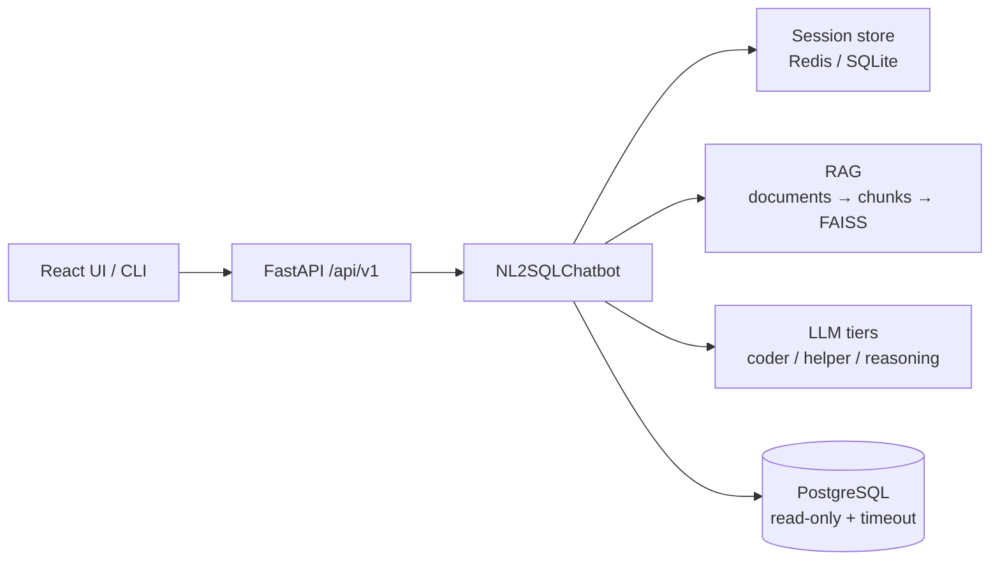

# NL2SQL Agent

[简体中文](README.md) · **English**

[](https://github.com/xifanz42/nl2sql_agent/actions/workflows/ci.yml)


A natural-language query agent for PostgreSQL: ask in Chinese or English, retrieve domain documents, generate one read-only SQL query, execute it, and return results with analysis. Ships with a FastAPI + React/TypeScript web UI and a CLI.

> **Internal / self-hosted tool.** There is no login, multi-tenancy, or permission system; deploy it behind company SSO / a reverse proxy, never directly on the public internet.

## Capabilities

| Capability | Description |
|---|---|
| Natural-language queries | Chinese / English question → RAG retrieval → SQL generation → read-only execution → analysis |
| Web UI | React + TypeScript; chat history, SQL, result table, analysis, on-demand usage |
| Chinese / English UI | Interface, status, and error messages switch between Simplified Chinese and English |
| CLI | `python app/cli.py`, for scripts or quick local checks |
| Sessions | Redis first, SQLite fallback; UUID sessions, TTL, short-term compaction |
| Document upload | 28 extensions (text/code, PDF, Office, EPUB); 10 MB default; unique `upload-<uuid>-<name>` files |
| Query safety | Single read-only statement only (`SELECT` / `UNION` / `INTERSECT` / `EXCEPT`); `sqlglot` validation; read-only transaction + timeout; row cap |
| Cost visibility | Per-request token usage and estimated CNY cost; oversized results return `too_many_rows` |

## Quickstart

Prerequisites:

- Python 3.10+
- Node.js (20+ recommended)
- A reachable PostgreSQL database (bring your own schema; no demo data is bundled)
- A SiliconFlow API key (SQL generation, analysis, and lightweight classification)

```bash
python -m venv .venv
source .venv/bin/activate
pip install -e ".[dev]"

cp .env.example .env
# Fill in SILICON_FLOW_API_KEY and DATABASE_*; Redis is optional
```

Build the frontend and start the app:

```bash
cd web
npm install
npm run build
cd ..

uvicorn app.api.main:app --reload
# Open http://127.0.0.1:8000/
```

CLI mode:

```bash
python app/cli.py
```

Run tests and lint:

```bash
pytest
ruff check .
```

CI runs the same `ruff` + `pytest` on Python 3.12; frontend builds currently run locally only.

## Architecture



Query path: question → session history → exploration/query classification → RAG retrieval → SQL generation → shared parser (SQL / clarification / refusal) → `sqlglot` validation → read-only execution → result analysis.

## API

Base path: `/api/v1`. The full interactive contract is available at `/docs` (Swagger) or `/openapi.json` once the app is running.

| Method | Path | Purpose |
|---|---|---|
| `GET` | `/health` | Liveness check |
| `GET` | `/config` | Public limits needed by the frontend (e.g. message length) |
| `POST` | `/chat` | Ask a natural-language question |
| `POST` | `/documents` | Upload a RAG document |

Ask a question:

```bash
curl -s http://127.0.0.1:8000/api/v1/chat \
  -H 'Content-Type: application/json' \
  -d '{"message":"查询 AT 车辆最近三天的平均导航速度"}'
```

The response contains `session_id` and `result`; `result.kind` may be `sql`, `clarification`, `refuse`, `exploration`, `execution_error`, `too_many_rows`, and so on. Reuse `session_id` on later requests to continue the conversation.

Upload a document:

```bash
curl -F "file=@notes.md" http://127.0.0.1:8000/api/v1/documents
```

Uploads are capped at 10 MB by default and support text/code, PDF, DOCX, XLSX, PPTX, RTF, ODT, ODS, and EPUB. Invalid filenames, extensions, or unsupported formats return 400; oversized files return 413.

## Security & Deployment

- **No auth / multi-tenancy.** Deploy behind SSO or a reverse proxy; bind to `127.0.0.1` where possible.
- The reverse proxy should enforce rate limits, body limits (1 MB for JSON, 12 MB for uploads), read timeouts, and a Host allowlist.
- SQL is limited to a single read-only query; the database connection sets `READ ONLY` and `statement_timeout`.
- Production should use a non-superuser, read-only database role; least-privilege roles and table allowlists are still planned.
- Treat the session UUID as a bearer token; do not share it publicly.
- Uploaded documents are treated as untrusted; parse failures return 4xx/5xx and remove the stored file.
- The current design assumes **a single worker**: the FAISS index and KB lock are process-local, and the SQLite fallback is not multiprocess-safe.

## Configuration

Core variables (see [`.env.example`](.env.example) for the full list):

| Variable | Required | Description |
|---|---:|---|
| `SILICON_FLOW_API_KEY` | Yes | LLM API key |
| `DATABASE_*` | Yes | PostgreSQL connection settings (`DATABASE_URL` also supported) |
| `REDIS_URL` | No | Session store; falls back to SQLite if Redis is unreachable at startup |
| `MAX_MESSAGE_CHARS` | No | Message length cap, default 2000 (2000/4000/8000 allowed) |
| `MAX_UPLOAD_BYTES` | No | Upload cap, default 10 MB |
| `EVAL_DATABASE_*` | No | Read-only role for evaluation; only needed for eval runs |

## Project Structure

```text
app/api       FastAPI routes, request/response models, upload handling
app/chatbot   conversation orchestration and session storage
app/core      database, LLM, RAG, parsing, SQL parsing
app/eval      evaluation harness and metrics
app/models    Pydantic models
web           React + TypeScript frontend
tests         unit tests and API contract tests
eval_results  public evaluation reports and history
data          local knowledge-base documents (not published)
kb_cache      generated FAISS / chunk cache (not published)
```

## Status & Roadmap

| Area | Status | Notes |
|---|---|---|
| Chat API + React UI + CLI | ✅ Done | End-to-end queries, result table, analysis, bilingual UI |
| Session isolation / TTL / compaction | ✅ Done | Redis first, SQLite fallback |
| Document upload + text / Office / PDF parsing | ✅ Done | 28 extensions, 10 MB default cap |
| RAG quality | 🚧 Next | Chunking, embeddings, retrieval evaluation |
| Long-term memory | 🗓️ Planned | Cross-session memory |
| Intent gate / multi-turn evaluation | 🗓️ Planned | Clarification convergence and multi-turn metrics |
| Runtime audit / table allowlist | 🗓️ Planned | Audit logging and least privilege |
| Docker / Node CI job | 🗓️ Planned | Self-hosting and frontend CI |

*Last updated: 2026-11-20.*

## Contributing

Issues and pull requests are welcome. Before opening a PR, run `pytest` and `ruff check .`, and keep changes focused.

## License

[MIT](LICENSE)
